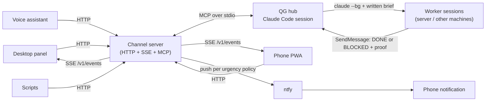

# claude-qg

*[English version](README.md)*

Une session Claude Code permanente qui me sert de « quartier général » (le QG) : je lui parle depuis un panneau sur mon bureau, un assistant vocal ou mon téléphone, elle délègue les tâches longues à des sessions de travail en arrière-plan, et elle me joint par un seul canal de notifications, avec une règle d'urgence explicite.


## Pourquoi ce projet

Claude Code tourne sur mon serveur à la maison, et je ne voulais plus surveiller des terminaux. Trois problèmes concrets se posaient :

1. **Un seul point d'entrée.** Je ne veux pas retenir quelle session ou quelle machine fait quoi. Une session toujours allumée reçoit les demandes de n'importe quel appareil et décide : répondre, faire, ou déléguer.
2. **Une délégation qui ne déraille pas.** Une session de travail démarre sans aucun contexte. Il lui faut une consigne écrite (but, périmètre, critère de fin, manière de rendre compte), et son compte rendu doit être vérifié avant d'être relayé : « ça marche » n'est pas une preuve.
3. **Des notifications qui ne deviennent pas du bruit.** Tout passe par un canal unique, et la notification sur le téléphone reste l'exception. Une urgence basse ne fait jamais sonner le téléphone, une urgence normale seulement si je n'ai pas vu le message sur un écran, une urgence haute tout de suite, et une question restée sans réponse donne lieu à un seul rappel.

Ce dépôt contient la partie réutilisable : le serveur du canal, et un modèle des instructions, des skills et des agents du QG, sans ce qui m'est personnel.

## Ce qu'il contient

- **`channel/`** : un serveur Bun/TypeScript qui est à la fois un « channel » MCP pour Claude Code et une API HTTP/SSE :
  outils `notify` et `reply`, `POST /message`, un `/v1/chat/completions` compatible OpenAI, un flux SSE avec rejeu (`/v1/events`), des accusés de lecture (`/v1/seen`), une file de sortie persistante, et la règle d'urgence pour ntfy (des fonctions pures dans `src/policy.ts`).
- **`template/CLAUDE.md.example`** : les instructions du QG sous forme de modèle : où se trouvent les choses, comment déléguer, grille modèle/effort, comment notifier, règles strictes.
- **`template/.claude/skills/`** : `worker-brief` (rédiger et lancer une consigne), `verify-worker` (vérifier un compte rendu avant de le relayer), `choose-model` (modèle et effort selon la tâche, réglages d'échantillonnage du LLM local), `create-agent-or-skill` (où ranger un savoir, circuit de validation).
- **`template/.claude/agents/`** : `verifier` (lecture seule, verdict prouvé) et `researcher` (faits sourcés et datés).
- **`template/run-qg.sh`, `statusline-qg.sh`** : le lanceur tmux/systemd avec redémarrage en boucle, et un hook de statusline qui enregistre les quotas pour que le QG les consulte avant de lancer plusieurs sessions coûteuses.
- **`docs/architecture.md`** : les schémas et le tableau de la règle d'urgence.

## Démarrage rapide : la démo (sans compte Claude, sans téléphone)

Il suffit de [Bun](https://bun.sh).

```bash
bun install
bun run demo
```

La démo démarre le serveur du canal avec un faux Claude Code sur son entrée/sortie standard et un faux serveur ntfy (le « téléphone »). Elle envoie quelques notifications comme le ferait un script, lit le flux SSE comme le ferait le panneau, envoie des accusés de lecture, et affiche ce que la règle a décidé. Les délais sont raccourcis (10 min deviennent 3 s, 45 min deviennent 6 s) : elle dure environ 12 secondes. La capture ci-dessus montre cette sortie.

## Architecture



Plus de détails (séquence de délégation, circulation des messages, invariants, modèle de sécurité) dans [`docs/architecture.md`](docs/architecture.md).

### Règle d'urgence

| Message | Panneau | Notification téléphone (ntfy) |
|---|---|---|
| Réponse à un message de l'utilisateur | oui | jamais |
| `notify`, `low` | oui | jamais |
| `notify`, `normal` (par défaut) | oui | une seule, s'il n'est toujours pas lu après 10 min |
| `notify`, `high` | oui | immédiatement |
| Question (`choices`) lue mais sans réponse | oui | un rappel après 45 min |

Une notification au plus par message. Un accusé de lecture annule les notifications en attente. Les détails et les invariants sont dans la documentation d'architecture et dans `channel/test/policy.test.ts`.

## L'utiliser pour de vrai

1. Copier `template/CLAUDE.md.example` dans le dossier du QG sous le nom `CLAUDE.md` et remplir les valeurs à adapter (machines, chemins, langue). Copier `template/.claude/` à côté.
2. Créer le secret et déclarer le canal (`template/.mcp.json.example` → `<dossier du QG>/.mcp.json`) : Claude Code lance lui-même `channel/src/channel.ts` comme serveur MCP.
3. Démarrer la session avec `template/run-qg.sh` (dans tmux, idéalement depuis une unité systemd utilisateur). Les canaux personnalisés ne sont pas sur la liste autorisée d'Anthropic : le lanceur passe donc `--dangerously-load-development-channels server:qg` et confirme l'avertissement que Claude Code affiche au démarrage.
4. Faire pointer les clients vers `http://<hôte>:<port>` avec `Authorization: Bearer <clé>` : `POST /message` pour un script ou un assistant vocal, `GET /v1/events` pour un panneau ou une application téléphone.

Exemple d'appel depuis un script :

```bash
curl -s -H "Authorization: Bearer $QG_CHANNEL_KEY" -H 'Content-Type: application/json' \
  -d '{"title":"Backup finished","text":"12 GB in 41 s","urgency":"low","from":"backup"}' \
  http://127.0.0.1:8098/v1/notify
```

## Configuration

Toute la configuration passe par des variables d'environnement (Bun lit aussi `.env`) ; voir [`.env.example`](.env.example).

| Variable | Défaut | Rôle |
|---|---|---|
| `QG_CHANNEL_KEY` / `QG_CHANNEL_KEY_FILE` | obligatoire | Secret partagé, envoyé comme `Authorization: Bearer ...` |
| `QG_CHANNEL_PORT` | `8098` | Port HTTP |
| `QG_CHANNEL_HOST` | `127.0.0.1` | Adresse d'écoute |
| `QG_CHANNEL_STATE` | `~/.local/state/qg` | File de sortie, marques de lecture, journal JSONL |
| `QG_OUTBOX_MAX` | `300` | Nombre de messages gardés pour le rejeu |
| `QG_REPLY_TIMEOUT_S` | `900` | Durée pendant laquelle un appelant HTTP attend le QG |
| `QG_USER_SENDERS` | `panel,voice,phone` | Expéditeurs considérés comme l'utilisateur (`trust=user`) ; tout autre est une donnée |
| `QG_NTFY_URL`, `QG_NTFY_TOPIC` | vide (pas de notification) | Serveur et sujet ntfy |
| `QG_NTFY_TOKEN`, `QG_NTFY_CLICK` | vide | Jeton d'écriture facultatif, modèle d'URL au clic (`{id}` remplacé) |
| `QG_NORMAL_DELAY_MIN` | `10` | Délai avant la notification d'un message `normal` non lu |
| `QG_QUESTION_REMINDER_MIN` | `45` | Délai avant le rappel d'une question sans réponse |
| `QG_POLICY_TICK_S` | `15` | Période d'évaluation de la règle |
| `QG_CHANNEL_NO_NTFY` | non défini | Désactive les notifications (tests) |

## Tests

```bash
bun install
bun run test        # 22 unit tests of the urgency policy (bun test)
bun run test:e2e    # 13 end-to-end tests (pytest): MCP handshake, HTTP, SSE replay, read receipts, push policy, restart
bun run typecheck
```

Les tests de bout en bout jouent le rôle de Claude Code (MCP sur l'entrée/sortie standard du serveur) et celui des clients, avec ntfy désactivé ; les décisions de notification sont relues dans le journal du canal. Ils utilisent `python3 -m pytest` et durent environ 20 secondes, car le test de la règle attend de vrais délais (raccourcis).

## Arborescence

```
channel/
  src/channel.ts        MCP server + HTTP/SSE API + outbox persistence
  src/policy.ts         urgency policy, answer matching, notify validation (pure functions)
  demo/demo.ts          the demo: fake Claude Code + fake ntfy + scripted clients
  test/                 bun unit tests + pytest end-to-end tests
template/
  CLAUDE.md.example     hub instructions, generic
  .claude/skills/       worker-brief, verify-worker, choose-model, create-agent-or-skill
  .claude/agents/       verifier, researcher
  run-qg.sh, statusline-qg.sh, .mcp.json.example, .claude/settings.json.example
docs/                   architecture.md, demo.png
scripts/render_terminal.py   renders the demo output to docs/demo.png (Playwright)
```

## État et limites

- C'est la version extraite et généralisée d'une installation que j'utilise tous les jours à la maison, traduite en anglais et débarrassée de mes chemins, de mes machines et de mes règles personnelles. Le code du canal a été nettoyé et configuré par variables d'environnement pour ce dépôt ; les tests de bout en bout passent sur ce code nettoyé, mais l'intégration avec Claude Code (`--dangerously-load-development-channels`, `--remote-control`, `crossSessionInbound`, `claude --bg`) dépend de fonctions de Claude Code qui changent d'une version à l'autre : vérifiez la documentation actuelle.
- Le protocole des canaux (`notifications/claude/channel`) est, à ma connaissance, une fonction en préversion de recherche de Claude Code ; je ne l'ai pas revérifiée sur la dernière version pour ce dépôt.
- Un seul utilisateur, un seul QG. Pas d'authentification multi-utilisateurs : une clé partagée, et la confiance décidée par le champ `from` des clients authentifiés.
- Le panneau, l'assistant vocal et l'application téléphone qui lui parlent ne sont pas inclus. L'application téléphone (Bun + Hono + un front sans framework, connexion par passkey derrière une couche d'accès du proxy, mode démo avec un chat simulé) existe, mais elle est liée à mon infrastructure ; je ne l'ai pas nettoyée pour la publier.
- Le contenu des skills reprend mes propres conventions de travail (grille modèle/effort, règle d'escalade, « ne jamais relancer une consigne à l'identique »). Prenez-les comme un point de départ.
- Écrit avec des assistants de code IA (Claude Code). Je les vois comme l'équivalent moderne de Stack Overflow et des pages de manuel : je peux expliquer chaque choix fait ici, y compris pourquoi la règle d'urgence est un ensemble de fonctions pures et pourquoi les consignes vivent dans des fichiers.

## Licence

MIT, voir [LICENSE](LICENSE).
