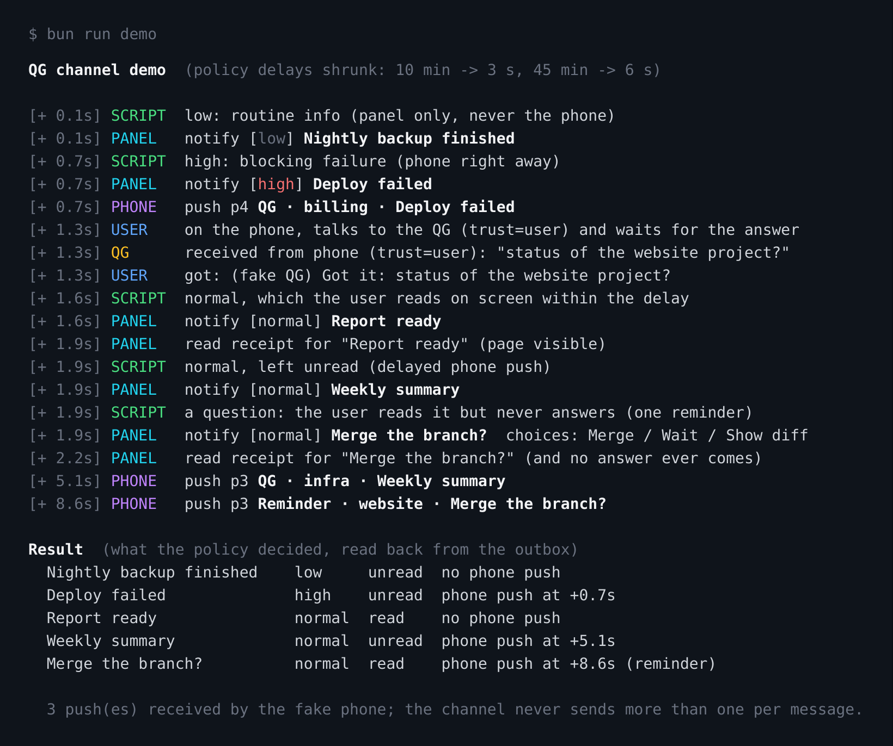
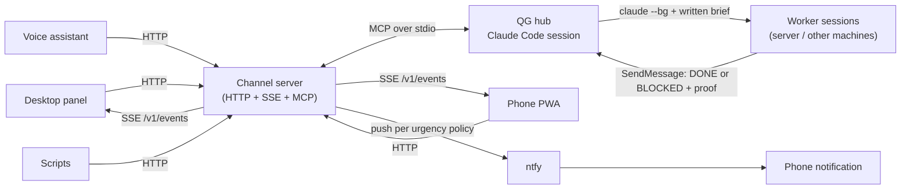

# claude-qg

*[Version française](README.fr.md)*

A permanent Claude Code session that acts as a personal "headquarters" (QG, from the French *quartier général*): you talk to it from a desktop panel, a voice assistant or a phone, it delegates long jobs to background worker sessions, and it reaches you through one notification channel with an explicit urgency policy.



## Why it exists

I run Claude Code on a home server and wanted to stop babysitting terminals. Three practical problems came up:

1. **One entry point.** I do not want to remember which session or machine does what. A single always-on session receives requests from any device and decides whether to answer, do it, or delegate.
2. **Delegation that does not go wrong.** Worker sessions start from an empty context. They need a written brief (goal, scope, done-criterion, how to report), and their reports must be checked before being relayed - "it works" is not evidence.
3. **Notifications that do not become noise.** Everything goes through one channel; a phone push is the exception, not the default. Low urgency never pings the phone, normal only if I did not see it on a screen, high immediately, and an unanswered question gets one reminder.

This repo is the reusable part: the channel server, and a template of the hub's instructions, skills and agents with my personal specifics removed.

## What is in it

- **`channel/`** - a Bun/TypeScript server that is both an MCP "channel" for Claude Code and an HTTP/SSE API:
  `notify` and `reply` tools, `POST /message`, an OpenAI-compatible `/v1/chat/completions`, an SSE stream with replay (`/v1/events`), read receipts (`/v1/seen`), a persistent outbox, and the ntfy urgency policy (pure functions in `src/policy.ts`).
- **`template/CLAUDE.md.example`** - the hub's instructions as a template: where things are, how to delegate, model/effort grid, how to notify, hard rules.
- **`template/.claude/skills/`** - `worker-brief` (write and launch a brief), `verify-worker` (check a report before relaying), `choose-model` (model and effort per task, local LLM sampling settings), `create-agent-or-skill` (where knowledge goes, approval flow).
- **`template/.claude/agents/`** - `verifier` (read-only, proven verdict) and `researcher` (sourced, dated facts).
- **`template/run-qg.sh`, `statusline-qg.sh`** - tmux/systemd launcher with restart loop, and a statusline hook that saves quota data so the hub can look at it before starting several expensive workers.
- **`docs/architecture.md`** - diagrams and the policy table.

## Quick start: the demo (no Claude account, no phone)

Needs [Bun](https://bun.sh) only.

```bash
bun install
bun run demo
```

The demo starts the channel server with a fake Claude Code on its stdio and a fake ntfy server (the "phone"), sends a few notifications as a script would, reads the SSE stream as the panel would, sends read receipts, and prints what the policy decided. Delays are shrunk (10 min becomes 3 s, 45 min becomes 6 s), so it takes about 12 seconds. The capture above is that output.

## Architecture



More detail (delegation sequence, message flow, invariants, security model) in [`docs/architecture.md`](docs/architecture.md).

### Urgency policy

| Message | Panel | Phone push (ntfy) |
|---|---|---|
| Reply to something the user wrote | yes | never |
| `notify`, `low` | yes | never |
| `notify`, `normal` (default) | yes | one push if still unread after 10 min |
| `notify`, `high` | yes | immediately |
| Question (`choices`) read but unanswered | yes | one reminder after 45 min |

At most one push per message. Read receipts cancel pending pushes. Details and invariants are in the architecture doc and in `channel/test/policy.test.ts`.

## Using it for real

1. Copy `template/CLAUDE.md.example` to your hub directory as `CLAUDE.md` and fill in the placeholders (machines, paths, language). Copy `template/.claude/` next to it.
2. Create the secret and register the channel (`template/.mcp.json.example` -> `<hub dir>/.mcp.json`): Claude Code launches `channel/src/channel.ts` itself as an MCP server.
3. Start the session with `template/run-qg.sh` (inside tmux, ideally from a systemd user unit). Custom channels are not on Anthropic's allowlist, so the launcher passes `--dangerously-load-development-channels server:qg` and confirms the warning that Claude Code prints at start.
4. Point clients at `http://<host>:<port>` with `Authorization: Bearer <key>`: `POST /message` for a script or voice assistant, `GET /v1/events` for a panel or phone app.

Example call from a script:

```bash
curl -s -H "Authorization: Bearer $QG_CHANNEL_KEY" -H 'Content-Type: application/json' \
  -d '{"title":"Backup finished","text":"12 GB in 41 s","urgency":"low","from":"backup"}' \
  http://127.0.0.1:8098/v1/notify
```

## Configuration

All configuration is environment variables (Bun also reads `.env`); see [`.env.example`](.env.example).

| Variable | Default | Purpose |
|---|---|---|
| `QG_CHANNEL_KEY` / `QG_CHANNEL_KEY_FILE` | required | Shared secret, sent as `Authorization: Bearer ...` |
| `QG_CHANNEL_PORT` | `8098` | HTTP port |
| `QG_CHANNEL_HOST` | `127.0.0.1` | Bind address |
| `QG_CHANNEL_STATE` | `~/.local/state/qg` | Outbox, marks, JSONL log |
| `QG_OUTBOX_MAX` | `300` | Messages kept for replay |
| `QG_REPLY_TIMEOUT_S` | `900` | How long an HTTP caller waits for the hub |
| `QG_USER_SENDERS` | `panel,voice,phone` | Senders treated as the user (`trust=user`); any other is data |
| `QG_NTFY_URL`, `QG_NTFY_TOPIC` | empty (push off) | ntfy server and topic |
| `QG_NTFY_TOKEN`, `QG_NTFY_CLICK` | empty | Optional write token, click URL template (`{id}` replaced) |
| `QG_NORMAL_DELAY_MIN` | `10` | Delay before a push for an unread `normal` message |
| `QG_QUESTION_REMINDER_MIN` | `45` | Delay before the reminder on an unanswered question |
| `QG_POLICY_TICK_S` | `15` | Policy evaluation period |
| `QG_CHANNEL_NO_NTFY` | unset | Disable pushes (tests) |

## Tests

```bash
bun install
bun run test        # 22 unit tests of the urgency policy (bun test)
bun run test:e2e    # 13 end-to-end tests (pytest): MCP handshake, HTTP, SSE replay, read receipts, push policy, restart
bun run typecheck
```

The end-to-end tests play the role of Claude Code (MCP over the server's stdio) and of the clients, with ntfy disabled; push decisions are read back from the channel log. They use `python3 -m pytest` and take about 20 seconds because the policy test waits for real (shrunk) delays.

## Project layout

```
channel/
  src/channel.ts        MCP server + HTTP/SSE API + outbox persistence
  src/policy.ts         urgency policy, answer matching, notify validation (pure functions)
  demo/demo.ts          the demo: fake Claude Code + fake ntfy + scripted clients
  test/                 bun unit tests + pytest end-to-end tests
template/
  CLAUDE.md.example     hub instructions, generic
  .claude/skills/       worker-brief, verify-worker, choose-model, create-agent-or-skill
  .claude/agents/       verifier, researcher
  run-qg.sh, statusline-qg.sh, .mcp.json.example, .claude/settings.json.example
docs/                   architecture.md, demo.png
scripts/render_terminal.py   renders the demo output to docs/demo.png (Playwright)
```

## Status and limits

- It is the extracted, generalised version of a setup I run daily at home, translated to English and stripped of personal paths, hosts and rules. The channel code was cleaned and given environment-based configuration for this repo; the end-to-end tests pass against the cleaned code, but the Claude Code integration (`--dangerously-load-development-channels`, `--remote-control`, `crossSessionInbound`, `claude --bg`) depends on Claude Code features that change between versions - check the current docs.
- The channel protocol (`notifications/claude/channel`) is a Claude Code research-preview feature as far as I know; I did not verify it against the latest release for this repo.
- Single user, single hub. No multi-tenant auth: one shared key, trust decided by the `from` field of authenticated clients.
- The panel, voice assistant and phone PWA that talk to it are not included. The phone app (Bun + Hono + a vanilla front end, passkey login behind a reverse-proxy access layer, demo mode with simulated chat) exists but is tied to my own infrastructure; I did not clean it for publication.
- The skills' content encodes my own working conventions (model/effort grid, escalation rule, "never relaunch a brief unchanged"). Treat them as a starting point.
- Built with AI coding assistants (Claude Code). I see them as the modern equivalent of Stack Overflow and man pages: I can explain every design choice here, including why the policy is a set of pure functions and why briefs live in files.

## Licence

MIT, see [LICENSE](LICENSE).
